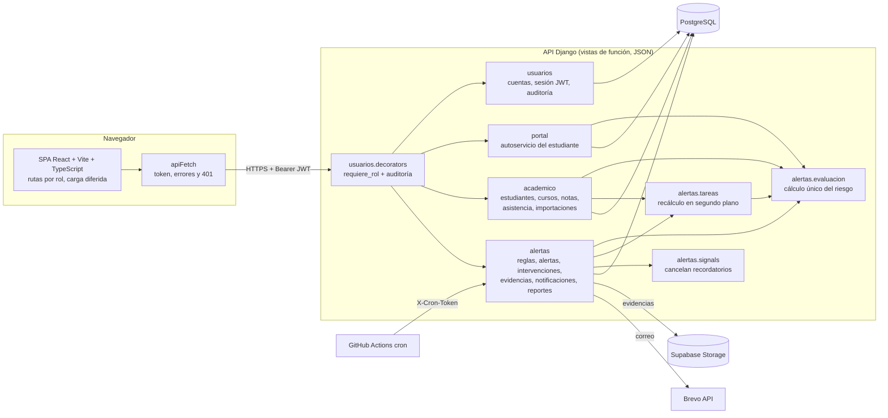
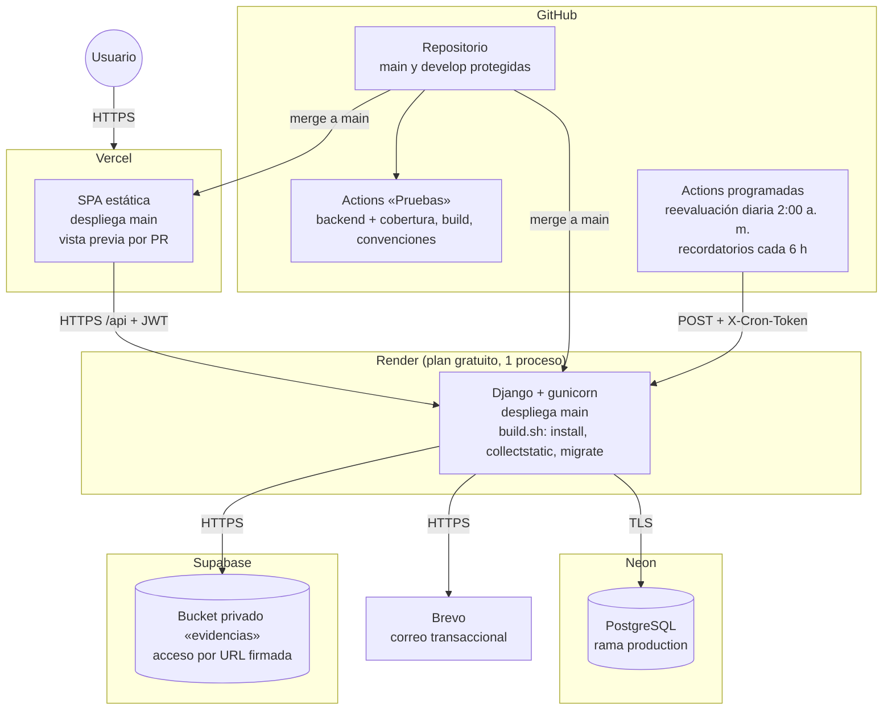
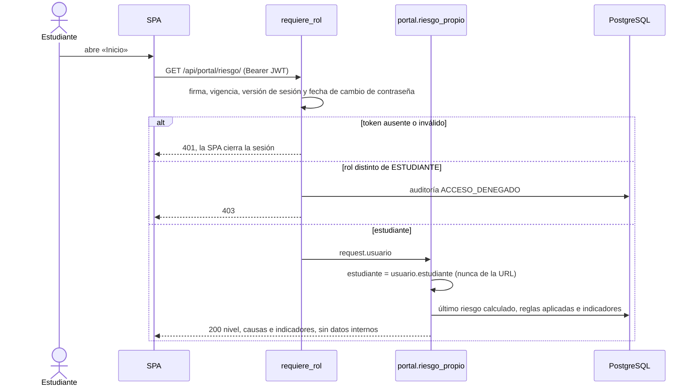
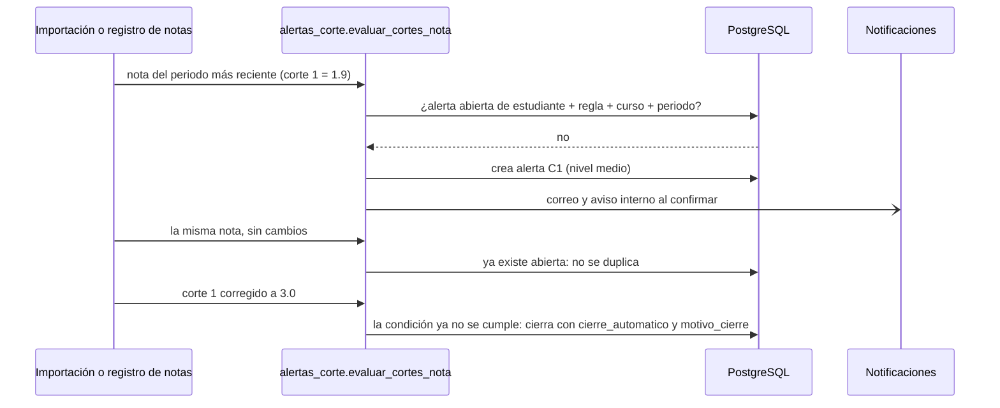

# Arquitectura del Sistema de Alertas Tempranas Académicas (SAT-UFPS)

Versión del sistema descrita: v1.3.x (Sprint 7). Los diagramas usan Mermaid; GitHub los muestra sin herramientas adicionales.

Documentos relacionados: contrato de la API en [`openapi.yaml`](openapi.yaml), casos de referencia del riesgo en [`Casos_Referencia_Riesgo.md`](Casos_Referencia_Riesgo.md), matriz de autorización en [`Matriz_Autorizacion.md`](Matriz_Autorizacion.md) y manual en [`Manual_Usuario_SAT.md`](Manual_Usuario_SAT.md).

## 1. Componentes



| Componente | Responsabilidad | Ubicación |
| --- | --- | --- |
| SPA | Pantallas por rol, validación de formularios, manejo de sesión | `FRONTEND/src/app` |
| `apiFetch` | Única salida HTTP del frontend: agrega el token, interpreta errores y cierra la sesión ante un 401 | `FRONTEND/src/services/apiFetch.ts` |
| `usuarios` | Usuario propio con cinco roles, inicio y cierre de sesión, recuperación de contraseña, bitácora de auditoría | `BACKEND/.../usuarios` |
| `portal` | Consultas del estudiante sobre sus propios datos (HU-37 a HU-42) | `BACKEND/.../portal` |
| `academico` | Datos académicos e importaciones DIRPLAN | `BACKEND/.../academico` |
| `alertas` | Reglas de riesgo, generación y cierre de alertas, seguimiento, notificaciones y reportes | `BACKEND/.../alertas` |
| `alertas.evaluacion` | Promedio acumulado, materias reprobadas, atraso y evaluación de reglas | `BACKEND/.../alertas/evaluacion.py` |

## 2. Dependencias entre módulos y su justificación

| Dependencia | Por qué existe |
| --- | --- |
| Todo cálculo de riesgo pasa por `alertas.evaluacion` | Las importaciones, el nivel de riesgo, la generación de alertas y la reevaluación deben llegar al mismo resultado con los mismos datos. Con el cálculo repetido en varios sitios, las pantallas mostraban cifras distintas. |
| Toda vista pasa por `requiere_rol` | Un solo punto decide el acceso, deja `request.usuario` y registra en auditoría cada acceso denegado. La matriz completa se verifica en `pruebas_integracion/test_matriz_roles.py`. |
| El portal toma al estudiante del token | Ninguna ruta del portal recibe el código del estudiante, de modo que un estudiante no puede pedir datos de otro cambiando un parámetro. |
| El portal tiene serializadores propios | Lista blanca de campos: observaciones, anotaciones, evidencias y datos del personal nunca llegan al estudiante aunque se agreguen campos al modelo. |
| Las importaciones y los cambios de reglas usan `alertas.tareas` | El recálculo masivo tarda; en producción corre en un hilo y la petición responde de inmediato. En pruebas corre de forma síncrona para que el resultado sea verificable. |
| Las señales cancelan recordatorios | Una intervención, anotación o evidencia puede guardarse por la API, por el administrador de Django o por un comando. La señal cubre todos los caminos de escritura. |
| Alertas con tres orígenes separados | Reglas generales (`services.py`), cortes (`alertas_corte.py`) e inasistencia (`alertas_inasistencia.py`) tienen ciclos de vida distintos: las de curso se evalúan solo en el periodo más reciente y se cierran solas. |
| El correo sale por la API HTTP de Brevo | Render bloquea SMTP saliente. |
| `academico` depende de `alertas.models.Regla` para la inasistencia | El umbral general de inasistencia es el valor de la regla INASISTENCIA activa; el curso puede tener el suyo. |

## 3. Despliegue



| Nodo | Entorno | Configuración relevante |
| --- | --- | --- |
| Vercel | Frontend | `VITE_API_URL` apunta al backend |
| Render | Backend | `DEBUG=False`, `SECRET_KEY`, `ALLOWED_HOSTS`, `DATABASE_URL`, claves de Brevo y Supabase, tokens de los cron |
| Neon | Base de datos | Esquema versionado con migraciones de Django |
| Supabase Storage | Evidencias | Bucket privado; el backend entrega URL firmadas de corta duración |
| GitHub Actions | Integración continua y tareas programadas | Sin secretos para las pruebas: usan SQLite |

Flujo de entrega: rama por incidencia → pull request a `develop` con aprobación y pruebas → pull request de `develop` a `main` → despliegue automático → prueba de humo en producción → etiqueta de línea base.

## 4. Secuencias

### 4.1 Importación de un historial y reevaluación

```mermaid
sequenceDiagram
  actor Admin as Administrador
  participant SPA
  participant API as academico (import_views)
  participant BD as PostgreSQL
  participant T as alertas.tareas
  participant E as alertas.evaluacion
  participant A as alertas (corte y reglas)
  participant B as Brevo

  Admin->>SPA: selecciona historial_<código>.xlsx y confirma
  SPA->>API: POST /api/academico/import/history/ (Bearer)
  API->>API: requiere_rol(ADMINISTRADOR), firma y tamaño del archivo
  API->>API: valida todas las filas
  alt hay errores de fila
    API-->>SPA: 400 con {fila, campo, valor, mensaje}; no se guarda nada
  else sin errores
    API->>BD: guarda notas en una transacción y registra bitácora
    API->>T: ejecutar_en_segundo_plano(recalcular)
    API-->>SPA: 200 resumen de la importación
    T->>E: calcular_indicadores + nivel_de_riesgo
    T->>A: genera, actualiza o cierra alertas
    A->>BD: alertas y riesgo del periodo
    A-)B: notificación (al confirmar la transacción)
  end
```

### 4.2 El estudiante consulta su riesgo



### 4.3 Alerta de corte: generación y cierre automático



## 5. Atributos de calidad medidos

| Atributo | Evidencia | Resultado |
| --- | --- | --- |
| Corrección | 663 pruebas del backend en cada PR; 18 especificaciones de extremo a extremo | Aprobadas |
| Cobertura | `coverage` en la integración continua | 87 % global (líneas y ramas); por líneas: alertas 90 %, portal 93 %, academico 86 %, usuarios 84 % |
| Seguridad de acceso | Matriz de 77 rutas por 5 roles y sin sesión | Sin desviaciones; cada denegación queda en auditoría |
| Rendimiento | Locust, 50 usuarios, 2 000 estudiantes, PostgreSQL local | 0 % de errores; p95 global 2,1 s; el umbral de 2 s por ruta no se cumple en 7 rutas (reportes 6,7 s) |
| Capacidad | Un proceso en Render gratuito | Entre 8 y 10 peticiones por segundo; dos procesos bajan el p95 a 1,6 s |
| Disponibilidad | Plan gratuito de Render | El servicio se suspende por inactividad; la primera petición puede tardar cerca de un minuto |
| Recuperación | Restauración de una instantánea de Neon en una rama; comando `respaldar_almacenamiento` para las evidencias | Base de datos probada; ver `SETUP.md` |

Limitaciones conocidas: sin inicio de sesión institucional (SSO) ni doble factor; respaldos manuales por el plan gratuito; el frontend no tiene pruebas unitarias, su cobertura es la de las pruebas de extremo a extremo.
