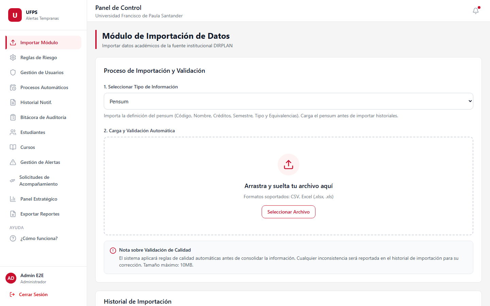
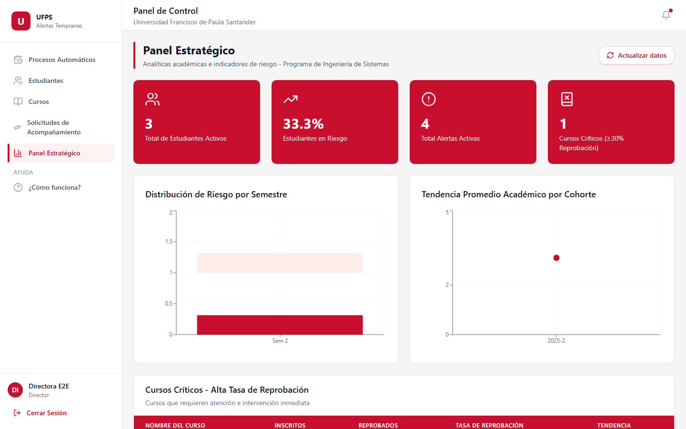
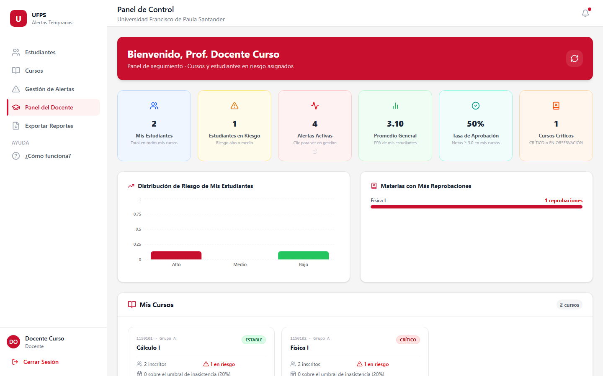
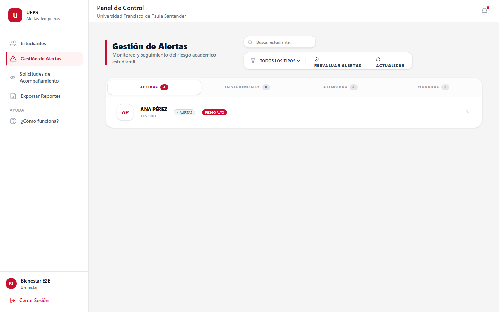
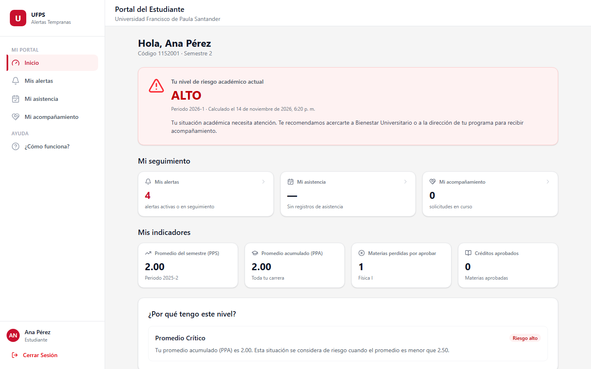

# Manual de usuario · SAT UFPS

Versión 1.0 · 14/11/2026 · SDAT-320. Capturas de la interfaz de la rama del PR, con datos ficticios de las pruebas E2E. La versión de producción puede diferir hasta integrar y desplegar los PR.

## Acceso y recuperación

Abre el [SAT UFPS](https://alertas-tempranas-ufps.vercel.app/), introduce tu correo y contraseña y pulsa **Iniciar sesión**. El sistema abre la pantalla de tu rol. Si recibiste una contraseña temporal, debes cambiarla antes de usar el sistema.

Usa **¿Olvidaste tu contraseña?** para solicitar un enlace. Revisa correo no deseado. El mensaje de confirmación no revela si existe una cuenta. El enlace dura una hora y solo se utiliza una vez. Un estudiante registrado con correo institucional único puede activar su cuenta por este mismo flujo. Si no recibe el enlace, debe solicitar al administrador revisar sus datos.

En equipos compartidos, termina con **Cerrar Sesión**. Si el servidor tarda en iniciar, espera y reintenta. Antes de reenviar una importación o solicitud, comprueba si ya quedó registrada.

## Permisos por rol

| Rol | Uso principal | Pantallas |
|---|---|---|
| Administrador | Mantener información y configuración | Importación, estudiantes, cursos, alertas, reglas, usuarios, solicitudes, reportes, notificaciones, auditoría y procesos automáticos |
| Director | Revisar la situación académica del programa | Panel estratégico, estudiantes, cursos, solicitudes, notificaciones y procesos automáticos |
| Docente | Seguir sus cursos y estudiantes | Panel docente, estudiantes, cursos, asistencia, alertas, intervenciones, evidencias, reportes y notificaciones |
| Bienestar | Atender alertas y solicitudes | Estudiantes, alertas, intervenciones, evidencias, solicitudes, reportes y notificaciones |
| Estudiante | Consultar su situación y solicitar apoyo | Inicio, Mis alertas, Mi asistencia y Mi acompañamiento |

El servidor valida cada operación. El estudiante solo ve sus datos y no accede a observaciones, anotaciones ni evidencias internas del personal.

## Administrador

### Importar información

1. Abre **Importar Módulo** y selecciona el tipo de archivo.
2. Respeta el orden: pensum, docentes, oferta académica, estudiantes, historiales individuales y asistencia.
3. Verifica las columnas requeridas y carga el archivo.
4. Si aparece un error de fila, corrige y vuelve a importar. No se guardan parcialmente las filas de una importación rechazada.
5. Consulta el resultado y la bitácora; comprueba las notas y el riesgo de un estudiante de muestra.

| Archivo | Columnas |
|---|---|
| Pensum | Codigo, Nombre, Creditos, Semestre, Tipo, Equivale A |
| Historial individual | Periodo, Materia Base, Codigo Materia, Nombre Materia, Corte 1, Corte 2, Corte 3, Examen Final, Definitiva |
| Asistencia | Periodo, Codigo Estudiante, Materia, Fecha, Estado |

El código del estudiante debe aparecer en el nombre del archivo de historial y las materias deben existir en el pensum. En asistencia, **Materia** incluye código y grupo; el estudiante debe estar matriculado. Los estados admitidos son A/ASISTIO, F/FALTA y FJ/FALTA_JUSTIFICADA.

El periodo operativo de producción es **2026-2**. No importes un periodo posterior: cambiaría el periodo considerado actual.

### Usuarios, reglas y procesos

En **Gestión de Usuarios**, crea o edita cuentas del personal y su rol. La contraseña temporal del alta se muestra una vez: entrégala por un canal privado. Las cuentas de estudiante se asocian a estudiantes registrados; no se crean como cuentas del personal.

En **Reglas de Riesgo**, revisa tipo, operador, umbral y severidad. Las reglas de corte tienen edición restringida a umbral y estado. Guardar una regla inicia la reevaluación: espera el resultado antes de comparar indicadores. Una regla con alertas asociadas puede no admitir eliminación; conserva su trazabilidad y desactívala cuando corresponda.

En **Procesos Automáticos**, consulta reevaluaciones y configura recordatorios. Una ejecución aceptada puede seguir procesándose: verifica el historial.

## Director

Consulta indicadores y distribución del riesgo en el **Panel Estratégico**. Busca un estudiante por nombre o código y abre su ficha para revisar notas, evolución y alertas. Selecciona el periodo antes de interpretar los resultados. En **Cursos**, revisa la oferta; en **Solicitudes**, gestiona la atención según las acciones disponibles.

Si falta información, pide al administrador revisar las importaciones antes de concluir que el estudiante no tiene riesgo.

## Docente

1. Abre tu panel o **Cursos** y selecciona uno de tus cursos.
2. En **Tomar asistencia**, selecciona fecha y registra asistencia, falta o falta justificada; guarda.
3. Revisa porcentajes y alertas. La falta justificada cuenta como clase, pero no como falta.
4. En **Gestión de Alertas**, abre el estudiante y consulta el motivo de la alerta.
5. Registra tutoría, citación o remisión y adjunta evidencia desde la intervención si corresponde.
6. Concluye la intervención o cierra la alerta solo cuando proceda; confirma la acción en el diálogo.

Tu acceso está limitado a tus cursos y estudiantes. Si un listado está vacío, verifica que la oferta y las matrículas estén cargadas.

## Bienestar

Revisa alertas y **Solicitudes de Acompañamiento**, su motivo y estado. Registra cada actuación en la intervención correspondiente. Puedes adjuntar evidencias y observaciones internas; el estudiante no las ve. Al finalizar, revisa tanto el estado de la solicitud como el de la alerta relacionada.

En **Reportes**, selecciona tipo y filtros, comprueba la vista previa y exporta PDF o Excel. Verifica periodo y población antes de compartir resultados.

## Estudiante

- **Inicio:** consulta riesgo, causas, indicadores y evolución. Si faltan datos, el sistema informa esa limitación. El nivel de riesgo orienta el seguimiento y no sustituye la asesoría académica.
- **Mis alertas:** filtra por estado o periodo y abre el detalle para ver explicación y recomendación. Una alerta puede cerrarse automáticamente cuando deja de cumplirse su condición.
- **Mi asistencia:** revisa clases y porcentaje de faltas frente al umbral. Sin clases, no se calcula porcentaje. Reporta errores al docente.
- **Mi acompañamiento:** revisa intervenciones y solicitudes. Para pedir apoyo, elige motivo, describe tu situación, relaciona una alerta si corresponde y pulsa **Enviar solicitud**. Solo se admite una solicitud en curso. Si está disponible **Cancelar solicitud**, puedes cancelarla tras confirmar.

## Interpretar los datos

**PPA** es el promedio acumulado; **PPS**, el del semestre. Con tres cortes y examen, la definitiva es promedio de cortes × 70 % + examen × 30 %, redondeada a un decimal. La nota aprobatoria es 3,0.

El atraso considera materias de línea. Las alertas de corte no cambian por sí solas el riesgo global. La inasistencia usa faltas sin justificar sobre clases registradas, con el umbral configurado y un mínimo de clases.

## Problemas frecuentes

| Situación | Acción |
|---|---|
| No llega recuperación | Revisa spam y correo registrado; solicita revisión al administrador |
| Demasiados intentos | Espera el tiempo indicado o recupera tu contraseña |
| Importación rechazada | Corrige fila, campo o columnas y respeta el orden de carga |
| Acceso denegado | Confirma tu rol con el administrador |
| Pantalla sin datos | Revisa filtros, periodo e importaciones |
| Servidor no disponible | Espera y reintenta; conserva el mensaje si persiste |

Para reportar un problema, indica pantalla, rol, hora, pasos y resultado esperado. No adjuntes contraseñas, tokens, enlaces de recuperación ni datos personales innecesarios.

## Validación del manual

Las capturas corresponden a cinco recorridos automatizados en la base E2E local, que usa cuentas y registros ficticios. El equipo aún debe validar el manual sobre la versión integrada y desplegada; estas capturas no certifican el despliegue.
